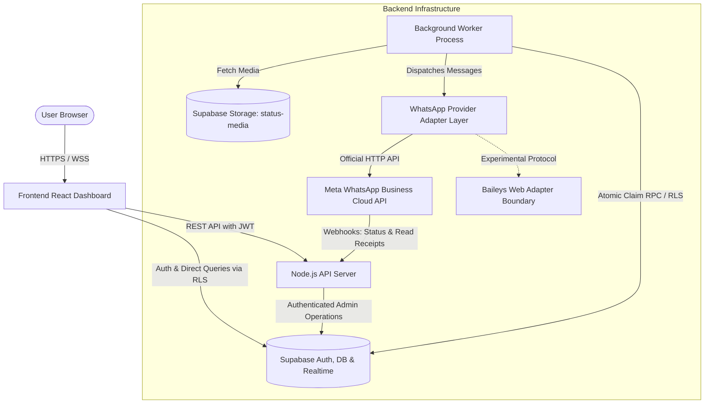

# WhatsAuto Architecture Documentation

## 1. Executive Summary & Overview

WhatsAuto is an enterprise-ready WhatsApp automation and campaign management platform built with high separation of concerns:
- **Frontend Dashboard**: React (Vite) + Tailwind CSS SPA, authenticated via Supabase Auth, delivering real-time status, CSV import preview, story scheduling preview, and direct sender workflow.
- **Application Backend**: Node.js (Express, ES Modules) API server providing authenticated endpoints, provider abstraction, rate limiting, and webhook ingest.
- **Background Workers**: Independent Node.js workers for story scheduling and message queue processing with atomic claiming, exponential backoff, bounded concurrency, and idempotency protection.
- **Managed Data Layer**: Supabase PostgreSQL database with Row-Level Security (RLS), Supabase Storage for private media assets, and Supabase Realtime for UI synchronization.

---

## 2. System Architecture Diagram



---

## 3. Component Responsibilities

### 3.1. Frontend Web Dashboard
- **Location**: `/frontend`
- **Tech Stack**: React 18, Vite, Tailwind CSS, Lucide React, Supabase SDK, PapaParse.
- **Responsibilities**:
  - Authenticates users via Supabase Auth (email/password or magic links).
  - Receives Supabase session JWT and forwards it in `Authorization: Bearer <token>` to the Node.js API.
  - Renders dark-mode interface (`#0B1120`, `#0F172A`, `#1E293B`, `#25D366`).
  - Provides 7 core sections: Dashboard Overview, Story Scheduler, Direct Sender, Device Connections, Live Queue, Delivery Logs, and Settings.
  - Validates CSV file structure client-side using PapaParse, detecting duplicates, missing names, and invalid phone numbers before submitting to the reviewable queue.
  - Subscribes to Supabase Realtime for instant UI reflection of queue states and delivery receipts.

### 3.2. Node.js Application Backend
- **Location**: `/backend`
- **Tech Stack**: Node.js (ES Modules), Express, `@supabase/supabase-js`, `dotenv`, `cors`, `helmet`.
- **Responsibilities**:
  - Enforces JWT validation on every route; extracts verified `user_id` from the Supabase auth context (never trusting client-supplied IDs).
  - Rate limits incoming requests and validates input payloads.
  - Manages campaign creation and pushes validated recipients into `message_queue`.
  - Exposes WhatsApp webhook endpoints with HMAC/token verification.
  - Exposes health (`/health`) and readiness (`/ready`) endpoints for monitoring.

### 3.3. Background Workers (Queue & Scheduler)
- **Location**: `/backend/src/workers`
- **Responsibilities**:
  - Runs in a continuous event loop decoupled from user HTTP requests.
  - **Message Queue Worker**: Uses a PostgreSQL RPC function (`claim_queue_jobs`) utilizing `FOR UPDATE SKIP LOCKED` for atomic job claiming, preventing race conditions across multiple instances.
  - Enforces rate limits (e.g., maximum messages per second per provider), respects recipient consent/opt-outs, and handles retries with exponential backoff.
  - **Story Scheduler Worker**: Polls `status_updates` for due jobs (`scheduled_at <= NOW() AND status = 'pending'`), checks provider capabilities, and updates execution state.

### 3.4. Supabase Infrastructure
- **PostgreSQL**: Stores relational data with strict RLS enforcement (`auth.uid() = user_id`).
- **Auth**: Issues verified JWTs with token rotation.
- **Storage**: Private bucket `status-media` with strict authenticated RLS policies, allowing only owners to upload, view, or delete media.
- **Realtime**: Publishes change events on `message_queue` and `delivery_logs` to subscribed clients.

---

## 4. WhatsApp Provider Integration Realities & Adapter Architecture

### 4.1. Official WhatsApp Business Cloud API vs. Stories / Statuses
- **Official WhatsApp Business Platform**:
  - Supports 1-on-1 direct messages using approved message templates and 24-hour service window session messages.
  - Does **NOT** provide a public API for publishing WhatsApp Statuses (stories) for standard business accounts.
  - WhatsAuto explicitly marks Story/Status publishing as **Experimental / Manual Workflow** when using official cloud credentials. The UI clearly informs the user: *"Automatic status publishing requires an active experimental web connection (e.g. Baileys session). When using official WhatsApp Business API, status reminders are queued for manual dispatch."*

### 4.2. Provider Adapter Interface
All messaging dispatch is routed through a standard provider interface:
```typescript
interface WhatsAppProvider {
  name: string;
  sendMessage(payload: SendMessageOptions): Promise<ProviderResult>;
  publishStatus?(payload: PublishStatusOptions): Promise<ProviderResult>;
  verifyWebhook(req: Request): boolean;
  parseWebhookEvent(req: Request): DeliveryEvent[];
  getHealth(): Promise<HealthStatus>;
}
```
Two adapters are provided:
1. `WhatsAppCloudAdapter`: Production Meta Cloud API using Graph API v20.0+.
2. `MockAdapter` / `BaileysAdapter` boundary: For authorized local development, automated testing, and experimental device pairing.

---

## 5. Security & Isolation Model
1. **Never Trust Client Input**: User IDs are decoded strictly from the validated Supabase Bearer token.
2. **Database Row Level Security (RLS)**: Even if a backend query missed a filter, database RLS blocks unauthorized queries for anon/authenticated roles.
3. **Redaction & Sanitization**: Error logs, logs tables, and API outputs strip phone numbers, tokens, and raw headers.
4. **Environment Isolation**: Service role keys and webhook secrets reside strictly in `.env` on the backend server, never bundled into frontend assets.
